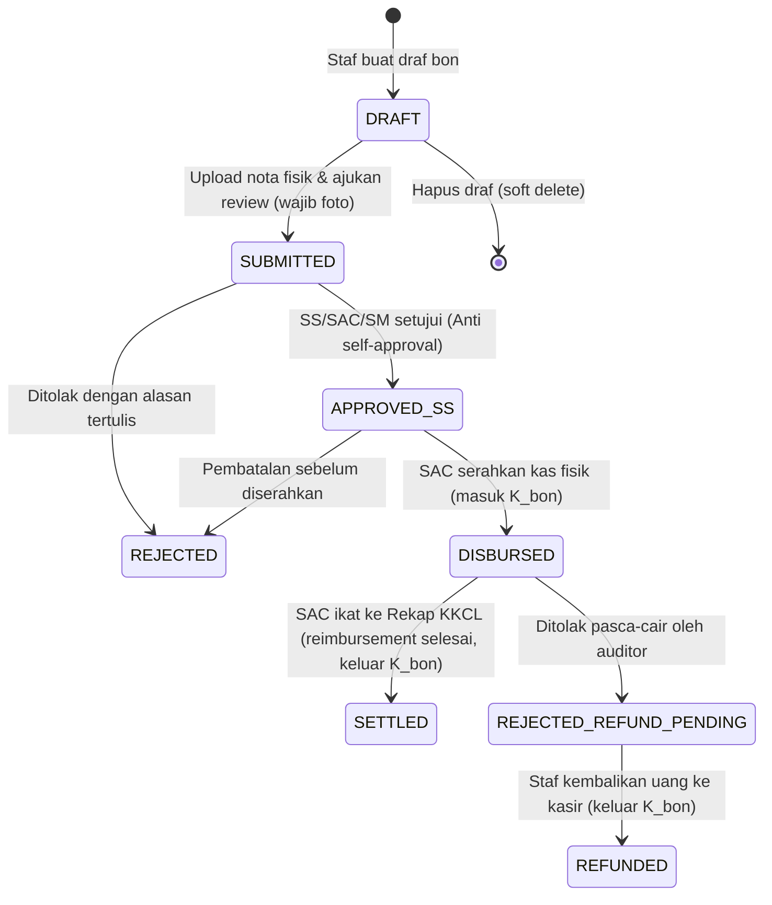
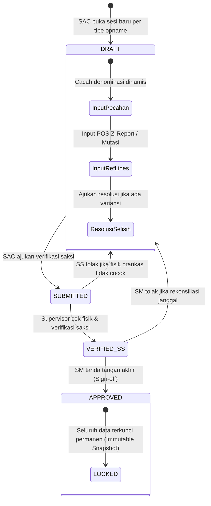

# MASTER SPECIFICATION & TECHNICAL BLUEPRINT: G-COINS
## Gramedia Cash Opname Internal System — Multi-Store Retail Platform
> **Versi Dokumen:** 2.2.0 (Master Unified Blueprint — Phase 8 Columnar Accounting Matrix, Dynamic Categories & KKCL Settlement Engine)  
> **Target Pengguna:** Pengembang Perangkat Lunak, System Architect, Business Analyst, QA Engineer, Auditor Internal  
> **Tujuan Dokumen:** Spesifikasi menyeluruh (*single source of truth*) yang mencakup logika bisnis, formula akuntansi, matriks wewenang, alur state machine, kamus data basis data, kontrak antarmuka Inertia.js, hingga arsitektur pelaporan Excel guna menjamin integritas finansial dan kepatuhan audit.

---

## DAFTAR ISI

1. [Ringkasan Eksekutif & Konteks Bisnis Toko Ritel](#1-ringkasan-eksekutif--konteks-bisnis-toko-ritel)
2. [Konsep Finansial: Model Rekonsiliasi & 5 Tipe Opname](#2-konsep-finansial-model-rekonsiliasi--5-tipe-opname)
3. [Rekonsiliasi Rekening Pooling Bank BRI & Buku Pembantu Mutasi](#3-rekonsiliasi-rekening-pooling-bank-bri--buku-pembantu-mutasi)
4. [Matriks Pecahan Fisik Denominasi & Definisi Item Dinamis](#4-matriks-pecahan-fisik-denominasi--definisi-item-dinamis)
5. [Precision Accounting: Outstanding Variance & Resolution Ledger](#5-precision-accounting-outstanding-variance--resolution-ledger)
6. [Struktur Hak Akses (RBAC), SoD & Tiered Dual Control](#6-struktur-hak-akses-rbac-sod--tiered-dual-control)
7. [State Machine & Alur Kerja Bisnis End-to-End](#7-state-machine--alur-kerja-bisnis-end-to-end)
8. [Kamus Data & Model Entitas Basis Data (Data Dictionary)](#8-kamus-data--model-entitas-basis-data-data-dictionary)
9. [Kontrak Antarmuka (Inertia.js SPA), Validasi Input & Kode Kesalahan](#9-kontrak-antarmuka-inertiajs-spa-validasi-input--kode-kesalahan)
10. [Pipeline Pengolahan Media & Multi-Lampiran](#10-pipeline-pengolahan-media--multi-lampiran)
11. [Format Berita Acara Resmi & Mesin Spreadsheet Excel (.xlsx)](#11-format-berita-acara-resmi--mesin-spreadsheet-excel-xlsx)
12. [Infrastruktur Deployment, Production Migration & Low-RAM Environment](#12-infrastruktur-deployment--low-ram-environment)

---

## 1. RINGKASAN EKSEKUTIF & KONTEKS BISNIS TOKO RITEL

### 1.1. Latar Belakang Masalah
Di unit ritel toko buku **Gramedia** (dengan pilot store Toko Gramedia World Karawang - Store Code `10435`), pengelolaan kas operasional dan pencacahan fisik kas (*cash opname*) harian dijalankan oleh kasir (**Staff Administrative Clerk / SAC**) di bawah pengawasan langsung **Store Supervisor (SS)** dan persetujuan akhir **Store Manager (SM)**.

Sebelum sistem G-COINS dibangun, proses verifikasi fisik kas dan pertanggungjawaban nota belanja manual memiliki kerentanan audit yang fatal:
1. **Risiko Kesalahan Formula & Manipulasi Data Spreadsheet:** Input manual ribuan keping koin dan lembar uang rentan salah ketik, formula SUM Excel terhapus, atau file tertimpa.
2. **Rekening Penampung Gabungan (Pooling Account Bank BRI):** Rekening koran operasional BRI toko menampung berbagai dana unit secara bercampur (Kas Kecil, Penjualan B2B sekolah/instansi, Pameran/Event bazar, dan Active Selling). Kasir kesulitan memisahkan porsi murni kas kecil tanpa perhitungan kertas cakar yang rawan selisih.
3. **Bon Gantung Tercecer (Unreimbursed Vouchers):** Karyawan toko lintas divisi meminjam uang tunai untuk operasional mendesak. Nota fisik sering hilang atau terlambat di-reimburse ke kantor pusat, menyebabkan selisih kas brankas semu.
4. **Bug Osilasi Selisih (Variance Oscillation Trap):** Jika selisih kas (*shortage/surplus*) di-carry forward secara naif ke periode berikutnya tanpa buku besar penyelesaian (*resolution ledger*), angka selisih akan berosilasi hilang-muncul pada sesi genap jika kasir belum menyetorkan fisik pengganti.
5. **Skop Kas Terfragmentasi:** Verifikasi tidak hanya terbatas pada Kas Kecil, melainkan mencakup Kas Besar (omzet Register POS), penjualan bazar event luar toko (*Active Selling*), bea materai toko, dan kartu voucher belanja Gramedia.

### 1.2. Tujuan Sistem G-COINS
G-COINS menghadirkan otomasi rekonsiliasi kas berbasis web PWA / Inertia.js Monolith SPA yang:
- Mengunci integritas matematis rekonsiliasi 5 tipe kas opname harian.
- Mengeliminasi bug osilasi variansi menggunakan model **Outstanding Variance + Resolution Ledger**.
- Menerapkan **Segregation of Duties (SoD)** dan **Tiered Dual Control** (Anti-Maker-Checker & batasan ambang wewenang).
- Mencatat riwayat mutasi rekening bank secara transparan per entitas/mitra.
- Mengompresi bukti nota fisik dari kamera staf secara instan ($\le 250\text{ KB}$ WebP).
- Menerbitkan dokumen hukum Berita Acara Cash Opname (BACO) berformat resmi Excel (.xlsx) berformula native dan siap cetak A4 yang terkunci permanen (*immutable snapshot*).

---

## 2. KONSEP FINANSIAL: MODEL REKONSILIASI & 5 TIPE OPNAME

Sistem G-COINS mendukung 5 tipe cash count harian menggunakan **Polymorphic Strategy Pattern**:

```
┌────────────────────────────────────────────────────────────────────────┐
│               G-COINS POLYMORPHIC CASH OPNAME ENGINE                   │
└───────────────────────────────────┬────────────────────────────────────┘
                                    │
    ┌──────────────┬────────────────┼──────────────┬────────────────┐
    ▼              ▼                ▼              ▼                ▼
┌────────────┐ ┌────────────┐ ┌────────────┐ ┌────────────┐ ┌────────────┐
│ KAS_KECIL  │ │ KAS_BESAR  │ │ACTIVE_SELL │ │  MATERAI   │ │GIFT_VOUCHER│
│ Three      │ │ Cash Flow  │ │ Consignment│ │ Stock Count│ │Serial Stock│
│ Pockets    │ │ POS Sales  │ │ Bazaar/Evt │ │ Duty Stamp │ │ Gift Card  │
└────────────┘ └────────────┘ └────────────┘ └────────────┘ └────────────┘
```

### 2.1. Tipe 1: KAS_KECIL (Three Pockets Imprest Model)
Kas Kecil menggunakan prinsip **Imprest Fund System** dengan pagu plafon tetap (default: Rp5.000.000,00). Dana kas kecil terdistribusi ke dalam 3 kantong finansial:
1. **Kantong 1 — Fisik Brankas Kasir ($K_{\text{fisik}}$):** Uang kartal riil (lembar & koin) dihitung melalui pencacahan denominasi.
2. **Kantong 2 — Bon Gantung Valid ($K_{\text{bon}}$):** Akumulasi nominal voucher kas kecil berstatus `DISBURSED` yang uang fisiknya telah diserahkan ke pemohon namun belum di-reimburse oleh kantor pusat:
   $$K_{\text{bon}} = \sum v.\text{amount\_cents} \quad \forall v \in \text{Vouchers di mana } v.\text{status} = \text{DISBURSED}$$
3. **Kantong 3 — Porsi Kas Kecil di Rekening BRI ($K_{\text{bri}}$):** Bagian dana kas kecil yang masih tersimpan di rekening koran BRI toko setelah dikurangi pos titipan non-kas kecil.

$$\text{Total Actual (KAS\_KECIL)} = K_{\text{fisik}} + K_{\text{bon}} + K_{\text{bri}}$$

### 2.2. Tipe 2: KAS_BESAR (Cash Flow Turnover Model)
Menghitung omzet dan mutasi uang tunai brankas kasir utama toko:
- **Physical Count:** Total fisik uang kartal hasil setoran kasir-kasir register POS.
- **Expected Cash (Target):**
  $$\text{Target} = \text{Saldo Awal Brankas} + \sum \text{Penjualan Tunai POS (Z-Report)} - \sum \text{Setoran Bank (Drops)} - \sum \text{Pengeluaran (Payouts)}$$
- **Guard Khusus:** Wajib melampirkan minimal 1 baris referensi Register POS Z-Report beserta foto struk fisik Z-Report sebelum verifikasi saksi.

### 2.3. Tipe 3: ACTIVE_SELLING (Consignment / Mobile Bazaar Model)
Menghitung kas operasional pameran, bazar mall, atau penjualan buku keliling luar toko:
- **Physical Count:** Uang fisik hasil transaksi bazar.
- **Expected Cash (Target):**
  $$\text{Target} = \text{Modal Kas Awal} + \sum \text{Hasil Jual Konsinyasi} - \sum \text{Biaya Operasional Event} - \sum \text{Setoran ke Toko}$$

### 2.4. Tipe 4: MATERAI (Stock Count Physical Verification Model)
Verifikasi fisik bea materai toko (misal: denominasi Rp 10.000 dan Rp 6.000):
- **Physical Count:** Akumulasi fisik keping/lembar materai dalam kondisi **BAIK** (`condition = 'GOOD'`):
  $$K_{\text{fisik}} = \sum (\text{count} \times \text{nominal\_cents}) \quad \forall \text{item di mana } \text{condition} = \text{GOOD}$$
- **Expected Target (Saldo Buku Materai):**
  $$\text{Target} = \text{Stok Awal} + \text{Penerimaan Masuk} - \text{Pemakaian/Terjual} - \text{Materai Rusak}$$

### 2.5. Tipe 5: GIFT_VOUCHER (Serial Stock Tracking Model)
Pencacahan fisik lembar voucher belanja Gramedia (pecahan Rp 25.000, Rp 50.000, Rp 100.000):
- **Physical Count:** Akumulasi fisik lembar voucher yang dihitung kasir.
- **Expected Target:** Dihitung berdasarkan nilai rentang nomor seri aktif (`SERIAL_RANGE`) atau saldo kartu stok voucher toko (`STOCK_OPENING`).

---

## 3. REKONSILIASI REKENING POOLING BANK BRI & BUKU PEMBANTU MUTASI

### 3.1. Masalah Rekening Penampung (Pooling Account)
Rekening Bank BRI unit toko menampung beragam transaksi unit:
- Kas Operasional Toko (Porsi Kas Kecil)
- Dana Transaksi B2B (Penjualan korporat, sekolah, pengadaan dinas)
- Dana Kegiatan / Event Pameran (Bazar mall, book fair)
- Dana Active Selling (Aksel)
- Dana Anonim (Transfer masuk dari pihak ketiga yang belum teridentifikasi di m-banking)
- Pos Kustom Tambahan (Sewa booth bazar, retur vendor, dsb.)

### 3.2. Formula Porsi Bersih Kas Kecil BRI
$$\text{Net Kas Kecil}_{\text{BRI}} = S_{\text{mutasi}} - \left( S_{\text{B2B}} + S_{\text{Event}} + S_{\text{Aksel}} + S_{\text{Anonim}} + \sum S_{\text{custom}} \right)$$

Di mana pos pengurang bertindak sebagai saldo berjalan (*rolling sub-ledger balances*) yang **tidak di-reset ke Rp0** ketika satu sesi cash opname selesai.

### 3.3. Arsitektur Buku Pembantu Mutasi BRI (`BriFundPosting`)
1. **Mutasi Masuk (`INFLOW`):** Dicatat oleh SAC/SS saat ada transfer masuk, wajib melampirkan bukti transfer/slip. Status langsung **`APPROVED`** dan menambah saldo berjalan mitra.
2. **Mutasi Penarikan Keluar (`OUTFLOW`):** Dicatat saat dana ditarik keluar. Berstatus awal **`PENDING_SS`**. Saldo berjalan **belum terpotong** sebelum disetujui.
3. **Tiered Dual Control Approval:**
   - **Nominal $\le \text{Rp } 500.000$:** Dapat disetujui oleh Store Supervisor (SS) atau Store Manager (SM).
   - **Nominal $> \text{Rp } 500.000$:** **Wajib disetujui oleh Store Manager (SM)**. Persetujuan oleh SS wajib ditolak oleh sistem (403 Forbidden).
   - **Anti-Maker-Checker:** Pembuat mutasi DILARANG menyetujui mutasi yang dibuatnya sendiri.
4. **Zero-Deficit Guard (Anti-Minus):**
   $$\text{Nominal Outflow} \le S_{\text{entitas berjalan}}$$
   Penarikan yang melebihi saldo berjalan entitas ditolak seketika pada lapisan form request dan Action layer.

---

## 4. MATRIKS PECAHAN FISIK DENOMINASI & DEFINISI ITEM DINAMIS

Toko mengonfigurasikan pecahan fisik melalui tabel `opname_item_definitions` yang dikelompokkan dinamis via `group_label`:

### 4.1. Matriks 11 Pecahan Standar Rupiah (KAS_KECIL & KAS_BESAR)
| No | Kelompok | Pecahan Nominal | Input Kontrol | Satuan |
| :-: | :--- | :--- | :--- | :---: |
| 1 | Uang Kertas | Rp 100.000 | Lembar | Lembar |
| 2 | Uang Kertas | Rp 50.000 | Lembar | Lembar |
| 3 | Uang Kertas | Rp 20.000 | Lembar | Lembar |
| 4 | Uang Kertas | Rp 10.000 | Lembar | Lembar |
| 5 | Uang Kertas | Rp 5.000 | Lembar | Lembar |
| 6 | Uang Kertas | Rp 2.000 | Lembar | Lembar |
| 7 | Uang Kertas | Rp 1.000 (Kertas) | Lembar | Lembar |
| 8 | Uang Logam | Rp 1.000 (Koin) | Keping | Keping |
| 9 | Uang Logam | Rp 500 | Keping | Keping |
| 10 | Uang Logam | Rp 200 | Keping | Keping |
| 11 | Uang Logam | Rp 100 | Keping | Keping |

### 4.2. Ketentuan UX Traversal & Auto-Save
- **Numpad Traversal:** Menekan tombol <kbd>Enter</kbd> atau <kbd>Panah Bawah</kbd> pada PC kasir otomatis berpindah ke pecahan berikutnya dan memilih teks secara utuh (`select()`). Pada baris terakhir, menekan <kbd>Enter</kbd> otomatis memindahkan fokus ke tombol aksi simpan.
- **Debounced Autosave (800ms):** Setiap perubahan nominal disimpan ke database di latar belakang tanpa me-refresh halaman atau mengunci input kasir.
- **Unsaved Guard:** Listener `beforeunload` memperingatkan kasir jika mencoba menutup tab saat autosave masih pending.

---

## 5. PRECISION ACCOUNTING: OUTSTANDING VARIANCE & RESOLUTION LEDGER

### 5.1. Masalah Bug Osilasi (*The Oscillation Trap*)
Pada pendekatan lama, selisih kas $V_{\text{current}}$ dari sesi sebelumnya langsung dibawa menjadi $V_{\text{prev}}$ pada sesi berikutnya. Jika kasir tekor Rp 50.000 pada Sesi 1 ($V_1 = -50.000$), target Sesi 2 menjadi Rp 4.950.000. Jika uang fisik di Sesi 2 masih tetap Rp 4.950.000 (kasir belum sempat mengganti uang), sistem lama menghitung $4.950.000 - 4.950.000 = 0$ (`BALANCED`), sehingga selisih tekor **hilang semu secara otomatis** di sesi genap.

### 5.2. Model Akuntansi Buku Besar Resolusi
Untuk menghilangkan bug osilasi secara mutlak, G-COINS mengadopsi model **Outstanding Variance + Resolution Ledger**:

```
1. RawDiscrepancy      = Total_Actual - Target_Baseline
2. CumulativeResolved  = Σ (resolution.amount_cents WHERE status = 'APPROVED')
3. OutstandingVariance = RawDiscrepancy + CumulativeResolved
```

Dimana:
- `Total_Actual`: Nilai aktual terhitung (sesuai Reconciler tipe opname).
- `Target_Baseline`: Plafon dana tetap / expected target kasir.
- `RawDiscrepancy`: Selisih mentah fisik kasir terhadap target.
- `CumulativeResolved`: Akumulasi nilai tindakan penyelesaian yang telah disetujui resmi.
- `OutstandingVariance`: Nilai selisih bersih yang belum terselesaikan.

### 5.3. Klasifikasi Status Selisih
Status sesi ditentukan murni oleh `OutstandingVariance`:
| Nilai `OutstandingVariance` | Status | Keterangan |
| :---: | :---: | :--- |
| **$= 0$** | **`BALANCED`** | Kas dan administrasi seimbang sempurna. |
| **$> 0$** | **`SURPLUS`** | Kelebihan kas fisik terhadap catatan buku. |
| **$< 0$** | **`SHORTAGE`** | Kekurangan kas fisik (tekor) terhadap catatan buku. |

### 5.4. Siklus Buku Besar Resolusi (`variance_resolutions`)
Jika terjadi selisih, kasir atau supervisor mencatat tindakan resolusi:
1. **Jenis Resolusi (`kind`):**
   - `REPLACED`: Kasir mengganti kekurangan uang fisik ke dalam brankas.
   - `WRITE_OFF`: Penghapusan selisih atas persetujuan pimpinan (toleransi selisih).
   - `FOUND`: Penemuan uang atau nota yang sebelumnya tertinggal/terselip.
2. **Tiered Write-Off Approval:**
   - Write-off $\le \text{Rp } 1.000.000$: Dapat disetujui oleh **SS** atau **SM**.
   - Write-off $> \text{Rp } 1.000.000$: **Wajib disetujui oleh Store Manager (SM)**. Persetujuan oleh SS ditolak sistem (403 Forbidden).
3. **Kunci Permanen (*Immutable Snapshot*):**
   Saat Store Manager melakukan **Sign-off**, seluruh nilai ($K_{\text{fisik}}$, $K_{\text{bon}}$, $K_{\text{bri}}$, `raw_discrepancy_cents`, `cumulative_resolved_cents`, `outstanding_variance_cents`, reference lines, dan resolutions) terkunci secara permanen (**Read-Only**).

---

## 6. STRUKTUR HAK AKSES (RBAC), SOD & TIERED DUAL CONTROL

### 6.1. Definisi 5 Peran (Roles)
1. **SYSTEM_ADMIN (Global IT):** Peran teknis non-bisnis. Mengelola master data toko (`stores`), konfigurasi opname, dan memantau audit log lintas toko. Tidak boleh mengeksekusi transaksi keuangan.
2. **SM (Store Manager):** Otoritas tertinggi toko. Menyetujui Berita Acara opname (*Final Sign-off* & permanent lock), menyetujui write-off $> 1\text{ jt}$, dan menyetujui mutasi bank outflow $> 500\text{ rb}$.
3. **SS (Store Supervisor):** Pengawas operasional toko. Menyetujui voucher bon, memverifikasi fisik brankas sebagai saksi (`VERIFIED_SS`), dan menyetujui outflow $\le 500\text{ rb}$ serta write-off $\le 1\text{ jt}$.
4. **SAC (Staff Administrative Clerk):** Kasir dan pengelola administrasi brankas. Membuka sesi opname, mencairkan uang voucher (`DISBURSED`), mencatat mutasi BRI, dan menyusun Berita Acara.
5. **SOA (Store Operation Associate):** Staf lantai operasional toko. Hanya berhak mengajukan draf voucher bon kas kecil untuk belanja keperluan toko.

### 6.2. Aturan Segregation of Duties (SoD) & Anti-Escalation
1. **Pencegahan Privilege Escalation:**
   - Kasir (SAC) DILARANG membuat atau mengedit user dengan role $\ge$ `SS` (`SS`, `SM`, `SYSTEM_ADMIN`).
   - Hanya Store Manager (SM) dan `SYSTEM_ADMIN` yang berwenang menugaskan role supervisor ke atas.
2. **Anti Self-Role Escalation:**
   - Pengguna DILARANG memodifikasi role akunnya sendiri pada permintaan update profile/user.
3. **Pembatasan Reset PIN:**
   - Kasir (SAC) DILARANG me-reset PIN milik user dengan role $\ge$ `SS`.
   - Pengguna dilarang me-reset PIN akunnya sendiri melalui endpoint reset (wajib verifikasi PIN lama).
   - Panjang PIN minimal 6 digit numerik.
4. **Anti Self-Approval pada Voucher & Bank:**
   - Kasir (SAC) dilarang menyetujui voucher bon yang diajukan oleh dirinya sendiri.
   - Pembuat mutasi penarikan BRI dilarang menyetujui mutasinya sendiri.

### 6.3. Dual-Scope Category Protection & Settlement Finality
1. **Isolasi Master Kategori Global vs Toko**:
   - Kategori Global (`store_id = NULL`) hanya boleh dikelola (create/update/toggle) oleh `SYSTEM_ADMIN`. Staf toko (`SAC`/`SM`) DILARANG mengubah nama, kode, atau status keaktifan kategori global.
   - Kategori Khusus Toko (`store_id != NULL`) hanya boleh dibuat dan dikelola oleh `SAC` atau `SM` pada toko yang bersangkutan.
2. **Finalitas Rekapitulasi (KKCL Lock)**:
   - Voucher berstatus `DISBURSED` yang telah diikat ke dalam nomor rekapitulasi `PettyCashSettlement` seketika bertransisi menjadi `SETTLED`.
   - Voucher berstatus `SETTLED` yang telah memiliki `settlement_id` tidak dapat dimasukkan kembali ke rekapitulasi lain (*anti double-claim/double-settle*).

---

## 7. STATE MACHINE & ALUR KERJA BISNIS END-TO-END

### 7.1. Lifecycle Voucher Bon Kas Kecil (`PettyCashVoucher`)


### 7.2. Lifecycle Sesi Cash Opname (`CashOpnameSession`)


### 7.3. Lifecycle Rekapitulasi Kas Kecil (KKCL) & Columnar Accounting Matrix
1. **Penyusunan Rekap Kasir (SAC)**:
   - Kasir memilih rentang tanggal periode dan menyeleksi voucher berstatus `DISBURSED` yang belum di-reimburse.
   - Sistem menampilkan pratinjau matriks kolom (*columnar matrix pivot*) di mana setiap baris voucher dipetakan ke kolom kategori pengeluaran masing-masing.
2. **One-Click Instant Settlement**:
   - Menekan tombol **"Buat & Selesaikan Rekap"** seketika:
     - Menerbitkan nomor KKCL atomik: `{SEQ}/KKCL/{STORE_CODE}/{ROMAN_MONTH}/{YEAR}`.
     - Menyimpan dokumen header `PettyCashSettlement` berstatus `SETTLED`.
     - Mengikat seluruh voucher terkait via `settlement_id` dan mengubah status voucher menjadi `SETTLED` (sehingga langsung keluar dari perhitungan $K_{\text{bon}}$ cash opname).
3. **Cetak & Ekspor Langsung**:
   - Tampilan dokumen KKCL siap cetak langsung A4 Landscape via peramban (`window.print()`).
   - Ekspor berkas spreadsheet Excel (.xlsx) resmi berformula native `=SUM(...)` per kategori dan grand total.

### 7.4. Lifecycle Master Kategori Kas Kecil (`PettyCashCategory`)
1. **10 Kategori Standar Karawang (Global Scope)**:
   - `ALAT_TULIS`: Alat Tulis Kantor (ATK)
   - `KONSUMSI`: Konsumsi / Dapur Toko
   - `PERLENGKAPAN`: Perlengkapan Operasional
   - `KEBERSIHAN`: Kebersihan & Sanitasi Toko
   - `EKSPEDISI`: Ekspedisi & Pos Kilat
   - `MAINTENANCE`: Perbaikan & Perawatan Gedung/Peralatan
   - `FOTOCOPY`: Fotocopy & Penjilidan / Bea Materai
   - `PROMOSI`: Keperluan Promosi & Event Toko
   - `PARKIR`: Parkir & Retribusi Resmi
   - `KASBON`: Kasbon Karyawan Sementara
2. **Kategori Kustom Toko**:
   - Dibuat mandiri oleh SAC/SM toko sesuai dinamika belanja lokal tanpa mengganggu toko lain.
3. **Toggle Keaktifan**:
   - Kategori dapat dinonaktifkan (`is_active = false`) tanpa menghapus riwayat transaksi lama.

### 7.5. Mandatory Receipt Evidence Guard on Voucher Submission
1. **Strict Guard on Submit**:
   - Saat voucher diajukan (`is_submit: true`), berkas foto struk/kuitansi asli (`receipt_image`) **WAJIB** dilampirkan.
   - Sisi server melempar `ValidationException` (HTTP 422) dengan pesan informatif: *"Foto bukti fisik bon/kuitansi wajib dilampirkan sebelum voucher diajukan."*, mencegah kegagalan HTTP 500 fatal.
2. **Draft Tolerance**:
   - Mode penyimpanan draf (`is_submit: false`) diizinkan tanpa foto struk untuk memfasilitasi pencatatan awal belanja di lapangan.

---

## 8. KAMUS DATA & MODEL ENTITAS BASIS DATA (DATA DICTIONARY)

### 8.1. Konvensi Tipe Data Finansial
- **Presisi INTEGER Cents:** Seluruh nilai moneter disimpan sebagai integer sen terkecil dengan akhiran `_cents` (contoh: Rp 5.000.000,00 disimpan sebagai `500000000`) untuk menjamin **nol kesalahan floating-point biner**.
- **Primary Key:** String alfanumerik `CUID v2` (VARCHAR 32), time-sortable dan tahan tabrakan.
- **Multi-Tenancy:** Kolom `store_id` diterapkan di seluruh tabel operasional melalui Eloquent Global Scope (`HasStoreScope`).

---

### 8.2. Rincian Skema Tabel Basis Data (SQLite WAL)

#### 1. Tabel: `stores`
| Kolom | Tipe Data | Nullable | Default | Deskripsi |
|---|---|:---:|:---:|---|
| `id` | VARCHAR(32) | NO | CUID | Primary Key |
| `code` | VARCHAR(10) | NO | — | Kode toko unik (contoh: `10435`). **UNIQUE**. |
| `name` | VARCHAR(150) | NO | — | Nama resmi toko Gramedia |
| `address` | TEXT | YES | NULL | Alamat fisik toko |
| `is_active` | BOOLEAN | NO | TRUE | Status operasional toko |
| `created_at` / `updated_at` | DATETIME | NO | NOW() | Stempel waktu pembuatan & perubahan |

#### 2. Tabel: `store_opname_configs`
| Kolom | Tipe Data | Nullable | Default | Deskripsi |
|---|---|:---:|:---:|---|
| `id` | VARCHAR(32) | NO | CUID | Primary Key |
| `store_id` | VARCHAR(32) | NO | — | FK merujuk ke `stores.id` |
| `opname_type` | VARCHAR(20) | NO | — | `KAS_KECIL`, `KAS_BESAR`, `ACTIVE_SELLING`, `MATERAI`, `GIFT_VOUCHER` |
| `imprest_fund_cents` | INTEGER | NO | 500000000 | Plafon dana tetap / expected baseline (sen) |
| `reconciliation_mode` | VARCHAR(20) | NO | `THREE_POCKETS` | Mode rekonsiliasi |
| `has_voucher_integration` | BOOLEAN | NO | TRUE | Apakah terintegrasi dengan bon gantung |
| `has_bank_reconciliation` | BOOLEAN | NO | TRUE | Apakah terintegrasi dengan rekening BRI |
| `is_active` | BOOLEAN | NO | TRUE | Status keaktifan tipe opname pada toko ini |
| `config_json` | TEXT/JSON | YES | NULL | Konfigurasi tambahan |

#### 3. Tabel: `opname_item_definitions`
| Kolom | Tipe Data | Nullable | Default | Deskripsi |
|---|---|:---:|:---:|---|
| `id` | VARCHAR(32) | NO | CUID | Primary Key |
| `store_id` | VARCHAR(32) | NO | — | FK merujuk ke `stores.id` |
| `opname_type` | VARCHAR(20) | NO | — | Tipe opname (`KAS_KECIL`, `MATERAI`, dll.) |
| `label` | VARCHAR(100) | NO | — | Label antarmuka (misal: "Rp 100.000", "Materai 10k") |
| `nominal_cents` | INTEGER | NO | — | Nilai pecahan dalam sen |
| `unit` | VARCHAR(20) | NO | `Lembar` | Satuan ("Lembar", "Keping", "Pcs") |
| `group_label` | VARCHAR(50) | NO | — | Pengelompokan grid ("Uang Kertas", "Uang Logam", "Materai") |
| `sort_order` | INTEGER | NO | 0 | Urutan tampilan di grid kasir |
| `is_active` | BOOLEAN | NO | TRUE | Status keaktifan pecahan |

#### 4. Tabel: `users`
| Kolom | Tipe Data | Nullable | Default | Deskripsi |
|---|---|:---:|:---:|---|
| `id` | VARCHAR(32) | NO | CUID | Primary Key |
| `store_id` | VARCHAR(32) | YES | NULL | FK merujuk ke `stores.id` (NULL khusus SYSTEM_ADMIN) |
| `nik` | VARCHAR(20) | NO | — | Nomor Induk Karyawan. **UNIQUE**. |
| `name` | VARCHAR(100) | NO | — | Nama lengkap karyawan toko |
| `role` | VARCHAR(20) | NO | `SOA` | `SYSTEM_ADMIN`, `SM`, `SS`, `SAC`, `SOA` |
| `pin_hash` | VARCHAR(255) | NO | — | Hash PIN 6-digit (bcrypt/Argon2id) |
| `phone_number` | VARCHAR(20) | YES | NULL | Nomor kontak WhatsApp |
| `is_active` | BOOLEAN | NO | TRUE | Status keaktifan akun |

#### 5. Tabel: `cash_opname_sessions`
| Kolom | Tipe Data | Nullable | Default | Deskripsi |
|---|---|:---:|:---:|---|
| `id` | VARCHAR(32) | NO | CUID | Primary Key |
| `store_id` | VARCHAR(32) | NO | — | FK merujuk ke `stores.id` |
| `opname_number` | VARCHAR(50) | NO | — | Nomor BACO resmi (`001/KKCL/10435/IX/2026`). **UNIQUE**. |
| `opname_type` | VARCHAR(20) | NO | `KAS_KECIL` | 5 tipe opname polimorfik |
| `status` | VARCHAR(20) | NO | `DRAFT` | `DRAFT`, `SUBMITTED`, `VERIFIED_SS`, `APPROVED`, `REJECTED` |
| `date` | DATE | NO | TODAY() | Tanggal pelaksanaan opname |
| `imprest_fund_cents` | INTEGER | NO | 500000000 | Plafon dasar sesi opname (sen) |
| `previous_variance_cents` | INTEGER | NO | 0 | Selisih sesi approved sebelumnya ($V_{\text{prev}}$) |
| `physical_total_cents` | INTEGER | NO | 0 | Total kas fisik terhitung ($K_{\text{fisik}}$) |
| `vouchers_total_cents` | INTEGER | NO | 0 | Total bon gantung aktif ($K_{\text{bon}}$) |
| `bri_clean_balance_cents`| INTEGER | NO | 0 | Porsi bersih kas kecil di BRI ($K_{\text{bri}}$) |
| `total_actual_cents` | INTEGER | NO | 0 | Total nilai riil terhitung |
| `target_reconciled_cents`| INTEGER | NO | 500000000 | Target plafon rekonsiliasi |
| `raw_discrepancy_cents` | INTEGER | NO | 0 | Total Actual dikurangi Target Baseline |
| `cumulative_resolved_cents`| INTEGER | NO | 0 | Akumulasi nilai resolusi selisih yang disetujui |
| `outstanding_variance_cents`| INTEGER | NO | 0 | Selisih bersih yang belum terselesaikan |
| `current_variance_cents`| INTEGER | NO | 0 | Kompatibilitas variansi warisan |
| `variance_status` | VARCHAR(10) | NO | `BALANCED` | `BALANCED`, `SURPLUS`, `SHORTAGE` |
| `created_by_id` | VARCHAR(32) | NO | — | FK merujuk ke `users.id` (SAC pembuat) |
| `verified_by_ss_id` | VARCHAR(32) | YES | NULL | FK merujuk ke `users.id` (SS saksi fisik) |
| `approved_by_sm_id` | VARCHAR(32) | YES | NULL | FK merujuk ke `users.id` (SM sign-off) |
| `verified_ss_at` | DATETIME | YES | NULL | Stempel waktu verifikasi supervisor |
| `approved_sm_at` | DATETIME | YES | NULL | Stempel waktu pengesahan final manager (memicu lock) |
| `generated_excel_url` | VARCHAR(255) | YES | NULL | Path berkas Berita Acara Excel (.xlsx) |
| `signed_ba_scan_url` | VARCHAR(255) | YES | NULL | Path foto scan Berita Acara bertanda tangan basah |
| `notes` | TEXT | YES | NULL | Catatan operasional temuan brankas |

> **Indeks Kunci**: SQLite Partial UNIQUE Index: `uq_active_opname_session` ON `(store_id, opname_type)` WHERE `status IN ('DRAFT', 'SUBMITTED', 'VERIFIED_SS')`.

#### 6. Tabel: `opname_item_counts`
| Kolom | Tipe Data | Nullable | Default | Deskripsi |
|---|---|:---:|:---:|---|
| `id` | VARCHAR(32) | NO | CUID | Primary Key |
| `session_id` | VARCHAR(32) | NO | — | FK merujuk ke `cash_opname_sessions.id` (CASCADE) |
| `item_definition_id` | VARCHAR(32) | NO | — | FK merujuk ke `opname_item_definitions.id` |
| `count` | INTEGER | NO | 0 | Jumlah fisik lembar/keping ($\ge 0$) |
| `condition` | VARCHAR(20) | NO | `GOOD` | Kondisi fisik (`GOOD`, `DAMAGED`) |
| `expected_count` | INTEGER | NO | 0 | Jumlah saldo buku harapan |
| `subtotal_cents` | INTEGER | NO | 0 | Hasil kali `count` $\times$ `nominal_cents` |

#### 7. Tabel: `opname_reference_lines`
| Kolom | Tipe Data | Nullable | Default | Deskripsi |
|---|---|:---:|:---:|---|
| `id` | VARCHAR(32) | NO | CUID | Primary Key |
| `session_id` | VARCHAR(32) | NO | — | FK merujuk ke `cash_opname_sessions.id` (CASCADE) |
| `line_type` | VARCHAR(50) | NO | — | `Z_REPORT`, `BANK_DEPOSIT`, `PAYOUT`, `STOCK_OPENING`, `STOCK_RECEIVED`, `STOCK_USED`, `STOCK_DAMAGED`, `CONSIGNMENT_SALES`, `EVENT_EXPENSE`, `STORE_REMITTANCE`, `SERIAL_RANGE` |
| `reference_number` | VARCHAR(100) | YES | NULL | Nomor Z-Report, No. Slip Bank, No. Kartu Stok |
| `quantity` | INTEGER | NO | 0 | Jumlah unit |
| `amount_cents` | INTEGER | NO | 0 | Nilai nominal dalam sen |
| `proof_attachment_url` | VARCHAR(255) | YES | NULL | Foto bukti fisik struk Z-Report / slip setoran |
| `notes` | TEXT | YES | NULL | Catatan tambahan |
| `meta_json` | TEXT/JSON | YES | NULL | Payload JSON fleksibel |

#### 8. Tabel: `variance_resolutions`
| Kolom | Tipe Data | Nullable | Default | Deskripsi |
|---|---|:---:|:---:|---|
| `id` | VARCHAR(32) | NO | CUID | Primary Key |
| `store_id` | VARCHAR(32) | NO | — | FK merujuk ke `stores.id` |
| `session_id` | VARCHAR(32) | NO | — | FK merujuk ke `cash_opname_sessions.id` (CASCADE) |
| `opname_type` | VARCHAR(20) | NO | — | Tipe opname (`KAS_KECIL`, `KAS_BESAR`, dll.) |
| `kind` | VARCHAR(20) | NO | — | Tindakan: `REPLACED`, `WRITE_OFF`, `FOUND` |
| `amount_cents` | INTEGER | NO | 0 | Nilai resolusi dalam sen |
| `reason` | TEXT | NO | — | Alasan tertulis / dasar tindakan penyelesaian |
| `proof_attachment_url`| VARCHAR(255)| YES | NULL | Foto slip setoran penggantian uang kasir |
| `status` | VARCHAR(20) | NO | `PENDING` | `PENDING`, `APPROVED`, `REJECTED` |
| `created_by_id` | VARCHAR(32) | NO | — | FK merujuk ke `users.id` (pembuat pengajuan) |
| `approved_by_id` | VARCHAR(32) | YES | NULL | FK merujuk ke `users.id` (penyetuju resolusi) |
| `approved_at` | DATETIME | YES | NULL | Waktu persetujuan resolusi disahkan |
| `rejection_reason` | TEXT | YES | NULL | Alasan penolakan jika ditolak |

#### 9. Tabel: `bri_sub_ledgers` & `bri_custom_allocations`
- `bri_sub_ledgers`: Snapshot rekonsiliasi mutasi rekening koran BRI pada saat sesi opname dibuka. Kolom: `id`, `session_id` (UNIQUE), `bri_mutation_total_cents`, `b2b_allocation_cents`, `event_allocation_cents`, `aksel_allocation_cents`, `anonymous_allocation_cents`, `custom_allocations_total_cents`, `net_kas_kecil_bri_cents`, `statement_proof_url`.
- `bri_custom_allocations`: Pos alokasi kustom yang berelasi ke sub-ledger (`id`, `sub_ledger_id`, `name`, `amount_cents`, `notes`).

#### 10. Tabel: `bri_fund_postings`
| Kolom | Tipe Data | Nullable | Default | Deskripsi |
|---|---|:---:|:---:|---|
| `id` | VARCHAR(32) | NO | CUID | Primary Key |
| `store_id` | VARCHAR(32) | NO | — | FK merujuk ke `stores.id` |
| `category` | VARCHAR(20) | NO | — | `B2B`, `EVENT`, `AKSEL`, `ANONYMOUS`, `CUSTOM` |
| `custom_category_name`| VARCHAR(100)| YES | NULL | Nama kategori jika CUSTOM |
| `entity_name` | VARCHAR(150) | NO | — | Nama mitra / kegiatan |
| `type` | VARCHAR(10) | NO | — | `INFLOW` atau `OUTFLOW` |
| `amount_cents` | INTEGER | NO | — | Nominal transaksi dalam sen ($> 0$) |
| `purpose` | VARCHAR(255) | NO | — | Keterangan tujuan / rekening belanja |
| `proof_attachment_url`| VARCHAR(255)| YES | NULL | Path foto slip mutasi bank |
| `status` | VARCHAR(15) | NO | — | `PENDING_SS`, `APPROVED`, `REJECTED` |
| `created_by_id` | VARCHAR(32) | NO | — | FK merujuk ke `users.id` pembuat |
| `approved_by_id` | VARCHAR(32) | YES | NULL | FK merujuk ke `users.id` penyetuju |
| `approved_at` | DATETIME | YES | NULL | Stempel waktu persetujuan |
| `rejection_reason`| VARCHAR(255) | YES | NULL | Alasan jika ditolak |

#### 11. Tabel: `petty_cash_categories`
| Kolom | Tipe Data | Nullable | Default | Deskripsi |
|---|---|:---:|:---:|---|
| `id` | VARCHAR(32) | NO | CUID | Primary Key |
| `store_id` | VARCHAR(32) | YES | NULL | FK merujuk ke `stores.id` (NULL = Kategori Global Pusat) |
| `code` | VARCHAR(50) | NO | — | Kode unik kategori (misal: `ALAT_TULIS`, `KONSUMSI`) |
| `name` | VARCHAR(100) | NO | — | Nama tampilan kategori belanja |
| `description` | VARCHAR(255) | YES | NULL | Deskripsi cakupan pengeluaran |
| `sort_order` | INTEGER | NO | 0 | Urutan tampilan di dropdown & kolom matriks |
| `is_active` | BOOLEAN | NO | TRUE | Status keaktifan kategori |
| `created_at` / `updated_at` | DATETIME | NO | NOW() | Stempel waktu |

#### 12. Tabel: `petty_cash_settlements`
| Kolom | Tipe Data | Nullable | Default | Deskripsi |
|---|---|:---:|:---:|---|
| `id` | VARCHAR(32) | NO | CUID | Primary Key |
| `store_id` | VARCHAR(32) | NO | — | FK merujuk ke `stores.id` |
| `settlement_number` | VARCHAR(50) | NO | — | Nomor KKCL (`001/KKCL/TG-001/X/2026`). **UNIQUE**. |
| `total_amount_cents` | BIGINT | NO | 0 | Total nominal seluruh voucher dalam sen |
| `status` | VARCHAR(30) | NO | `SETTLED` | `SETTLED` (langsung selesai saat diterbitkan SAC) |
| `settled_by_id` | VARCHAR(32) | NO | — | FK merujuk ke `users.id` (kasir pembuat) |
| `notes` | TEXT | YES | NULL | Catatan operasional rekapitulasi kas kecil |
| `created_at` / `updated_at` | DATETIME | NO | NOW() | Stempel waktu |

#### 13. Tabel: `petty_cash_vouchers`
| Kolom | Tipe Data | Nullable | Default | Deskripsi |
|---|---|:---:|:---:|---|
| `id` | VARCHAR(32) | NO | CUID | Primary Key |
| `store_id` | VARCHAR(32) | NO | — | FK merujuk ke `stores.id` |
| `settlement_id` | VARCHAR(32) | YES | NULL | FK merujuk ke `petty_cash_settlements.id` (NULL saat bon belum direkap) |
| `voucher_number` | VARCHAR(50) | NO | — | Nomor bon resmi (`024/KKCL/10435/IX/2026`). **UNIQUE**. |
| `requester_id` | VARCHAR(32) | NO | — | FK merujuk ke `users.id` (staf pemohon) |
| `amount_cents` | INTEGER | NO | — | Nominal bon dalam sen ($> 0$, $\le$ plafon) |
| `purpose` | VARCHAR(255) | NO | — | Keperluan belanja operasional |
| `category` | VARCHAR(50) | NO | `OPERASIONAL` | Kode kategori merujuk ke `petty_cash_categories.code` |
| `status` | VARCHAR(30) | NO | `DRAFT` | `DRAFT`, `SUBMITTED`, `APPROVED_SS`, `DISBURSED`, `SETTLED`, `REJECTED`, `REJECTED_REFUND_PENDING`, `REFUNDED` |
| `receipt_image_url` | VARCHAR(255) | YES | NULL | Path foto struk nota belanja (WebP/JPEG, wajib saat submit) |
| `item_photo_url` | VARCHAR(255) | YES | NULL | Path foto fisik barang belanjaan (WebP/JPEG) |
| `approved_by_id` | VARCHAR(32) | YES | NULL | FK merujuk ke `users.id` (penyetuju bon) |
| `disbursed_by_id` | VARCHAR(32) | YES | NULL | FK merujuk ke `users.id` (SAC penyerah kas) |
| `disbursed_at` | DATETIME | YES | NULL | Waktu penyerahan kas (mulai masuk $K_{\text{bon}}$) |
| `settled_at` | DATETIME | YES | NULL | Waktu reimbursement diganti pusat |
| `rejection_reason`| VARCHAR(255) | YES | NULL | Alasan penolakan jika ditolak |
| `deleted_at` | DATETIME | YES | NULL | Soft delete untuk draf bon |

#### 14. Tabel Pendukung: `audit_logs`, `attachments`, `notifications`
- `audit_logs`: Mencatat riwayat finansial lengkap (`id`, `store_id`, `entity_name`, `entity_id`, `action`, `performed_by_id`, `old_values`, `new_values`, `ip_address`, `created_at`).
- `attachments`: Arsip dokumen pendukung (`id`, `store_id`, `entity_type`, `entity_id`, `category`, `file_name`, `file_path`, `file_size_bytes`, `mime_type`, `uploaded_by_id`).
- `notifications`: Notifikasi alur kerja in-app (`id`, `store_id`, `user_id`, `type`, `title`, `message`, `entity_type`, `entity_id`, `read_at`).

---

## 9. KONTRAK ANTARMUKA (INERTIA.JS SPA), VALIDASI INPUT & KODE KESALAHAN

Aplikasi dibangun murni menggunakan **Inertia.js v3** Monolith SPA (tanpa endpoint REST API terpisah). Controller mengembalikan render komponen React (`Inertia::render()`) atau *redirect response* dengan flash messages (`with('success', ...)`).

### 9.1. Daftar Rute Utama & Action Controller (`routes/web.php`)

#### A. Autentikasi & Akun
- `GET /login` &rarr; `Auth\AuthController@create` (Tampilan login NIK + PIN)
- `POST /login` &rarr; `Auth\AuthController@store` (Rate-limited login)
- `POST /logout` &rarr; `Auth\AuthController@destroy`
- `GET /profile` &rarr; `ProfileController@show`
- `PUT /profile/pin` &rarr; `ProfileController@updatePin`

#### B. Voucher Bon Kas Kecil & Settlement Rekap (KKCL)
- `GET /vouchers` &rarr; `VoucherController@index`
- `GET /vouchers/create` &rarr; `VoucherController@create` (Memuat kategori aktif toko)
- `POST /vouchers` &rarr; `VoucherController@store` (Validasi foto struk wajib saat submit)
- `GET /vouchers/{voucher}` &rarr; `VoucherController@show`
- `DELETE /vouchers/{voucher}` &rarr; `VoucherController@destroy` (Soft delete draf)
- `POST /vouchers/{voucher}/submit` &rarr; `VoucherController@submit` (Wajib foto nota)
- `POST /vouchers/{voucher}/approve` &rarr; `VoucherController@approve` (Validasi anti self-approval)
- `POST /vouchers/{voucher}/reject` &rarr; `VoucherController@reject` (Alasan wajib)
- `POST /vouchers/{voucher}/disburse` &rarr; `VoucherController@disburse` (SAC serahkan kas)
- `POST /vouchers/{voucher}/cancel` &rarr; `VoucherController@cancel` (Pasca-cair)
- `POST /vouchers/{voucher}/refund` &rarr; `VoucherController@refund` (Konfirmasi uang kembali)
- `GET /vouchers/pending` &rarr; `VoucherController@pending` (Antrean approval)
- `GET /vouchers/settlements` &rarr; `PettyCashSettlementController@index` (Arsip dokumen KKCL)
- `POST /vouchers/settlements` &rarr; `PettyCashSettlementController@store` (One-click instant settlement)
- `GET /vouchers/settlements/{settlement}` &rarr; `PettyCashSettlementController@show` (Matriks kolom & cetak A4 landscape)
- `GET /vouchers/settlements/{settlement}/export` &rarr; `PettyCashSettlementController@export` (Ekspor spreadsheet KKCL .xlsx)
- `GET /vouchers/export` &rarr; `VoucherController@export` (Ekspor dataset voucher dengan kolom M No. KKCL)

#### C. Cash Opname, Reference Lines & Resolutions
- `GET /opname` &rarr; `OpnameController@index` (Riwayat sesi)
- `POST /opname/start` &rarr; `OpnameController@start` (Buka/lanjutkan sesi per tipe)
- `GET /opname/active` &rarr; `OpnameController@active` (Workspace aktif)
- `GET /opname/{session}` &rarr; `OpnameController@show` (Detail read-only)
- `PUT /opname/{session}/denominations` &rarr; `OpnameController@updateDenominations` (Autosave 800ms)
- `PUT /opname/{session}/bri-subledger` &rarr; `OpnameController@updateBriSubledger`
- `POST /opname/{session}/bri-sync` &rarr; `OpnameController@syncBri`
- `POST /opname/{session}/reference-lines` &rarr; `OpnameController@storeReferenceLine`
- `DELETE /opname/{session}/reference-lines/{referenceLine}` &rarr; `OpnameController@destroyReferenceLine`
- `POST /opname/{session}/resolutions` &rarr; `OpnameController@storeResolution`
- `POST /opname/resolutions/{resolution}/approve` &rarr; `OpnameController@approveResolution` (Tier limit)
- `POST /opname/resolutions/{resolution}/reject` &rarr; `OpnameController@rejectResolution`
- `POST /opname/{session}/signed-ba` &rarr; `OpnameController@uploadSignedBa`
- `POST /opname/{session}/submit` &rarr; `OpnameController@submit` (Guard struk Z-Report KAS_BESAR)
- `POST /opname/{session}/verify` &rarr; `OpnameController@verify` (Saksi SS)
- `POST /opname/{session}/reject-ss` &rarr; `OpnameController@rejectSs`
- `POST /opname/{session}/sign-off` &rarr; `OpnameController@signOff` (SM approval & snapshot lock)
- `POST /opname/{session}/reject-sm` &rarr; `OpnameController@rejectSm`
- `GET /opname/{session}/report` &rarr; `OpnameController@report` (A4 Cetak)
- `GET /opname/{session}/export-excel` &rarr; `OpnameController@exportExcel` (Download .xlsx)

#### D. Bank Sub-Ledger (BRI Fund Postings)
- `GET /bri-funds` &rarr; `BriFundController@overview`
- `GET /bri-funds/postings` &rarr; `BriFundController@postings`
- `GET /bri-funds/create` &rarr; `BriFundController@create`
- `POST /bri-funds` &rarr; `BriFundController@store`
- `GET /bri-funds/pending` &rarr; `BriFundController@pending`
- `POST /bri-funds/{posting}/approve` &rarr; `BriFundController@approve` (Tiered Dual Control)
- `POST /bri-funds/{posting}/reject` &rarr; `BriFundController@reject`
- `GET /bri-funds/entity/{entityName}` &rarr; `BriFundController@entityDetail`
- `GET /bri-funds/balances` &rarr; `BriFundController@balances`

#### E. Master Kategori Kas Kecil (Expense Categories)
- `GET /admin/categories` &rarr; `PettyCashCategoryController@index` (Katalog master kategori)
- `POST /admin/categories` &rarr; `PettyCashCategoryController@store` (Isolasi skop toko vs global)
- `PUT /admin/categories/{category}` &rarr; `PettyCashCategoryController@update`
- `POST /admin/categories/{category}/toggle-status` &rarr; `PettyCashCategoryController@toggleStatus`

#### F. Administrasi & Import/Export Center
- `GET /admin/users` &rarr; `UserController@index`
- `POST /admin/users` &rarr; `UserController@store` (SoD: SAC dilarang buat user $\ge$ SS)
- `PUT /admin/users/{user}` &rarr; `UserController@update` (Anti-escalation)
- `POST /admin/users/{user}/reset-pin` &rarr; `UserController@resetPin` (SoD: SAC dilarang reset PIN SS/SM)
- `POST /admin/users/{user}/toggle-status` &rarr; `UserController@toggleStatus`
- `GET/PUT /admin/store-settings` &rarr; `StoreSettingsController@show / update`
- `GET /admin/audit-logs` &rarr; `AuditLogController@index`
- `GET /admin/audit-logs/export` &rarr; `AuditLogController@export`
- `GET /admin/import-export` &rarr; `ImportExportController@index`
- `GET /admin/import-export/export/{users|vouchers|categories|settlements|bri-postings|audit-logs}`
- `GET /admin/import-export/template/{type}` (Multi-sheet template dengan lembar katalog kategori)
- `POST /admin/import-export/preview` &rarr; Validasi baris per baris sebelum eksekusi (validasi kategori dinamis)
- `POST /admin/import-export/commit` &rarr; Terapkan import ke database

### 9.2. Kode Kesalahan & Penolakan Standar
- `FORBIDDEN_SELF_APPROVAL`: Petugas dilarang menyetujui pengajuan bon atau mutasi buatannya sendiri.
- `FORBIDDEN_ROLE`: Pengguna tidak memiliki wewenang untuk aksi ini.
- `FORBIDDEN_SOD_VIOLATION`: Upaya SAC mengelola role atau me-reset PIN milik level supervisor/manager ke atas.
- `TIERED_APPROVAL_REQUIRED`: Transaksi melebihi limit supervisor (wajib disetujui Store Manager).
- `INSUFFICIENT_RUNNING_BALANCE`: Saldo berjalan entitas tidak mencukupi untuk penarikan keluar (Zero-Deficit Guard).
- `SESSION_LOCKED`: Sesi opname telah disahkan oleh Store Manager dan berstatus read-only permanen.
- `MISSING_PHYSICAL_PROOF`: Sesi KAS_BESAR belum melampirkan foto struk fisik register POS Z-Report.
- `MISSING_RECEIPT_PROOF`: Voucher diajukan tanpa foto bukti struk (dikembalikan via HTTP 422 `ValidationException`).

---

## 10. PIPELINE PENGOLAHAN MEDIA & MULTI-LAMPIRAN

### 10.1. Kompresi Sisi Klien Berlapis (`image-compressor.ts`)
Foto asli kamera ponsel pintar (4 MB s/d 12 MB) wajib dikompresi di browser pengguna sebelum diunggah ke server:
1. File dibaca melalui Canvas API.
2. Dimensi dibatasi maksimal proporsional $1280 \times 1920\text{ px}$.
3. **Strict Size Guard ($\le 250\text{ KB}$):**
   - Iterasi kualitas kompresi WebP dari 0.85 turun bertahap hingga 0.3.
   - Jika pada kualitas 0.3 ukuran masih $> 250\text{ KB}$, kompresor mengeksekusi *two-stage dimensional scaling* (skala turun 80% &rarr; 60%) hingga berkas terkompresi dipastikan berukuran $\le 250\text{ KB}$.
4. **Fallback Safari iOS:** Jika peramban tidak mendukung konversi WebP langsung pada Canvas, berkas otomatis disimpan sebagai JPEG terkompresi valid berukuran $\le 250\text{ KB}$ (mencegah penamaan file WebP palsu).

---

## 11. FORMAT BERITA ACARA RESMI & MESIN SPREADSHEET EXCEL (.XLSX)

Sistem menggunakan pustaka `maatwebsite/excel` di Laravel untuk mengekspor Berita Acara Cash Opname (BACO) dan Rekapitulasi Kas Kecil (KKCL).

### 11.1. Standar Format Sel & Formula Native
- **Format Akuntansi Resmi:** `"Rp "#,##0;[Red]("-Rp "#,##0);"-"` (Nol ditampilkan sebagai tanda hubung `-`, angka minus berwarna merah dalam kurung).
- **Rumus Sel Native:** Sel subtotal dan total menggunakan rumus native spreadsheet (`=C8*D8`, `=SUM(...)`, `=E19+E25+E36`) sehingga berkas tetap dinamis dan transparan saat diaudit di Microsoft Excel.
- **Tata Letak Cetak A4:** Mengatur `fitToPage: true`, `fitToWidth: 1`, `fitToHeight: 0`, margin sempit (0.5 inci).
- **Bagian Tanda Tangan Tiga Pihak:** Mencantumkan nama lengkap dan NIK dari kasir pembuat (SAC), supervisor saksi fisik (SS), dan manager pengesah (SM).

### 11.2. Format Matriks Rekapitulasi Kas Kecil (KKCL) & Multi-Sheet Template
1. **Spreadsheet Rekapitulasi KKCL (`PettyCashSettlementExport`)**:
   - Berorientasi Landscape (`size: A4 landscape`).
   - Menyajikan matriks kolom kategori pengeluaran dinamis.
   - Kolom total per voucher di kanan dan baris total per kategori di bawah menggunakan formula native `=SUM(...)`.
2. **Multi-Sheet Template Import Voucher (`PettyCashVoucherTemplateExport`)**:
   - Lembar 1: *Template_Voucher* (format data siap isi).
   - Lembar 2: *Katalog_Kategori* (daftar referensi kode dan nama kategori aktif milik toko).
   - Formula validasi otomatis mencegah salah ketik nama kategori saat import massal.

---

## 12. INFRASTRUKTUR DEPLOYMENT, PRODUCTION MIGRATION & LOW-RAM ENVIRONMENT

### 12.1. Arsitektur Low-RAM VPS
Sistem dirancang secara khusus untuk berjalan stabil pada **VPS bersumber daya terbatas (1 vCPU, 1 GB – 2 GB RAM, 2 GB Swap)** yang berbagi sumber daya dengan service lain:
1. **Zero-Build Server:** Asset frontend (`React 19 + Tailwind CSS v4`) dikompilasi di komputer lokal pengembang (`npm run build`). VPS **tidak menginstal Node.js / NPM**, menghemat memori dan kapasitas disk.
2. **PHP-FPM Mode `ondemand`:** Worker PHP-FPM 8.4 melepaskan memori setelah 10 detik idle.
3. **Supervisor Queue Worker Minimalis:** 1 worker antrean background yang dibatasi maksimal memori 64 MB.
4. **SQLite WAL Mode:** Mengaktifkan `journal_mode = WAL`, `synchronous = NORMAL`, `busy_timeout = 5000`, dan `foreign_keys = ON`.
5. **Skrip Backup Otomatis:** Skrip cron mencadangkan basis data SQLite dan berkas upload secara berkala dengan rotasi 30 hari.

### 12.2. Prosedur Pembaruan Produksi VPS & Safe Migration Protocol
1. **Pencegahan Perintah Destruktif**:
   - Pada `AppServiceProvider.php`, Laravel mengaktifkan:
     ```php
     DB::prohibitDestructiveCommands($this->app->isProduction());
     ```
   - **Perintah `migrate:fresh` atau `migrate:reset` DIBLOKIR TOTAL di VPS** untuk melindungi integritas basis data finansial toko.
2. **Prosedur Update Resmi**:
   ```bash
   # 1. Tarik pembaruan kode dari GitHub
   git pull origin main

   # 2. Update dependensi tanpa dev
   composer install --no-dev --prefer-dist --optimize-autoloader --no-interaction

   # 3. Jalankan migrasi baru secara aman
   php artisan migrate --force

   # 4. Jalankan seeder kategori baru (jika ada)
   php artisan db:seed --class=PettyCashCategorySeeder --force

   # 5. Bersihkan dan segarkan cache konfigurasi & rute
   php artisan optimize:clear
   php artisan config:cache
   php artisan route:cache

   # 6. Pastikan izin kepemilikan direktori storage & cache
   sudo chown -R $USER:www-data storage bootstrap/cache
   sudo chmod -R 775 storage bootstrap/cache
   ```

---
> **Catatan Pengesahan Dokumen:**  
> Dokumen Master Spesifikasi Versi 2.2.0 ini adalah konsolidasi resmi dari seluruh arsip dokumen `docs/00` sampai `docs/14` di repositori G-COINS Toko Gramedia World Karawang. Disusun sebagai acuan tunggal yang presisi, mencerminkan seluruh implementasi Phase 8 (Columnar Matrix, Master Categories & KKCL Settlement Engine), dan siap diaudit.
