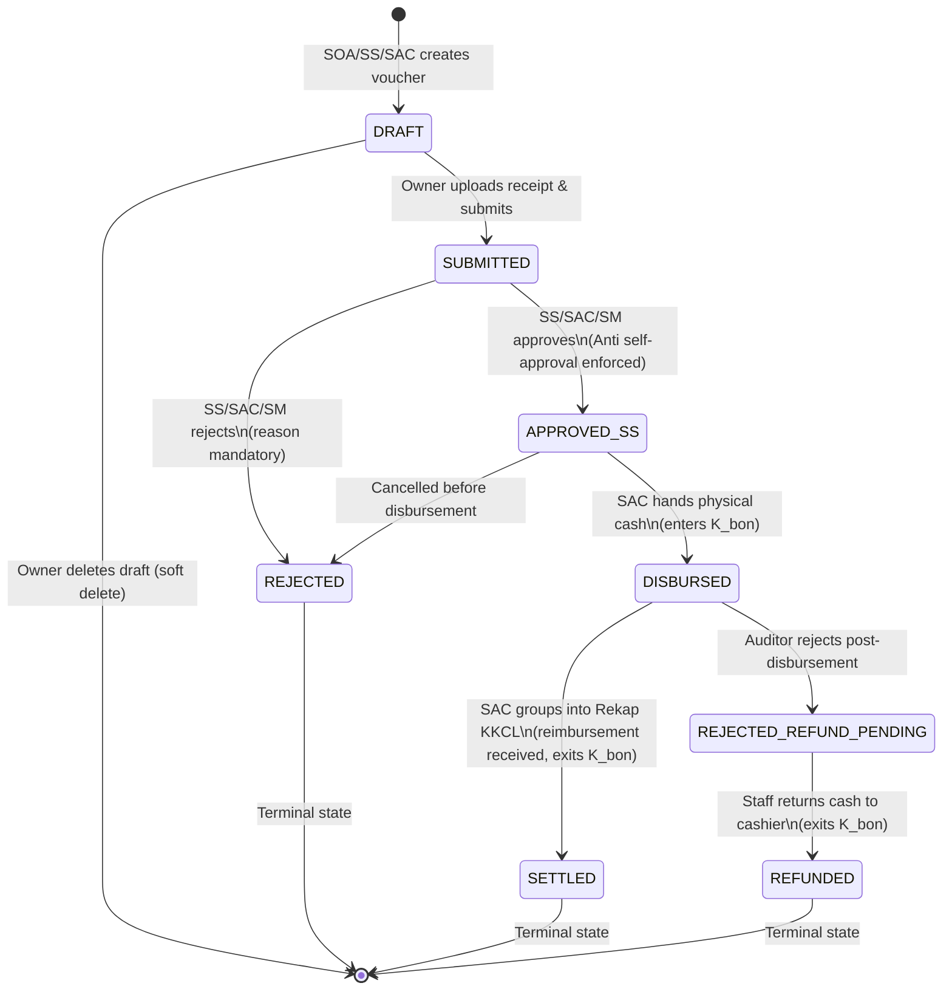
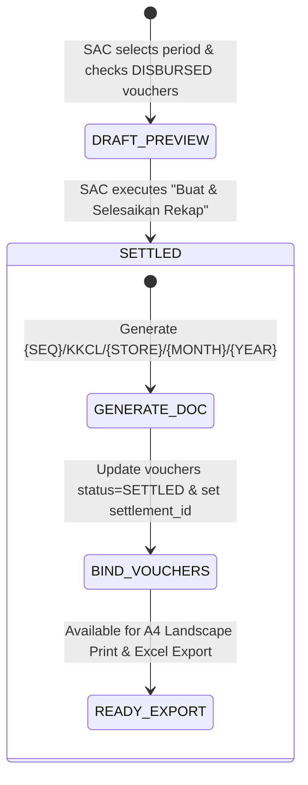
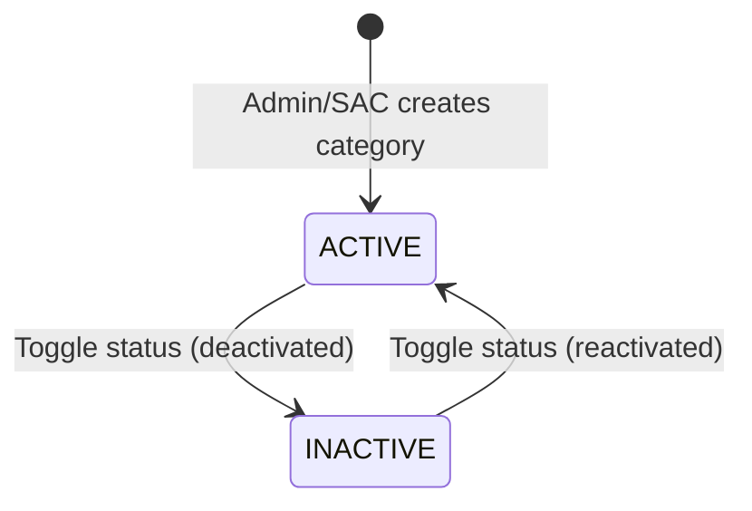
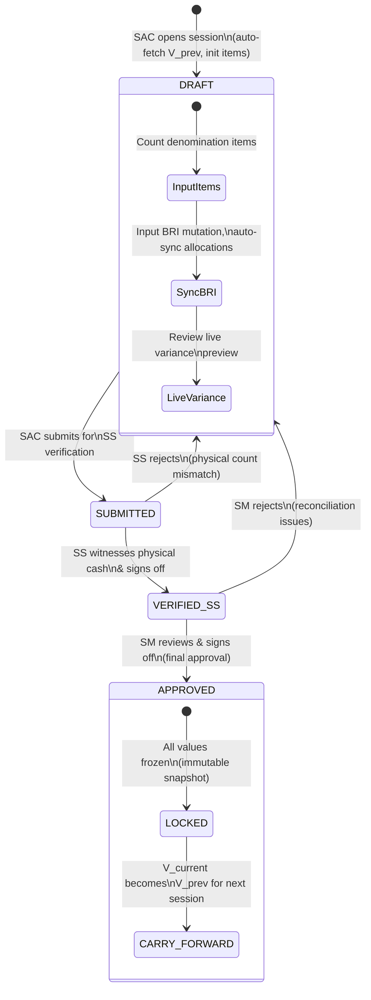
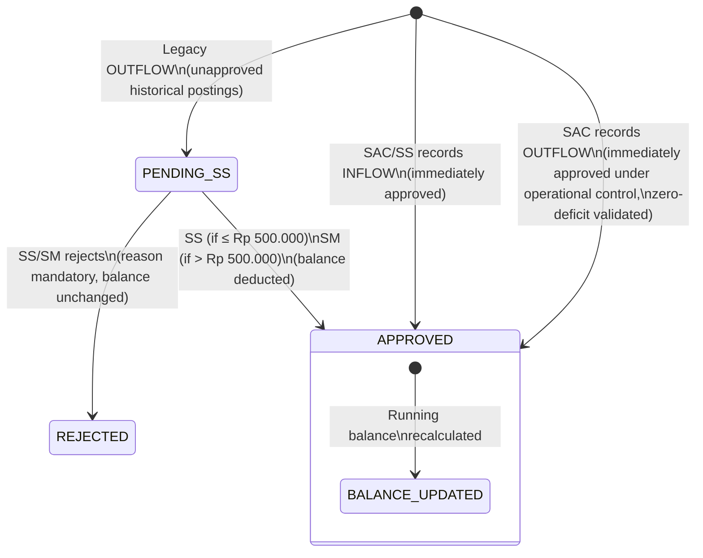
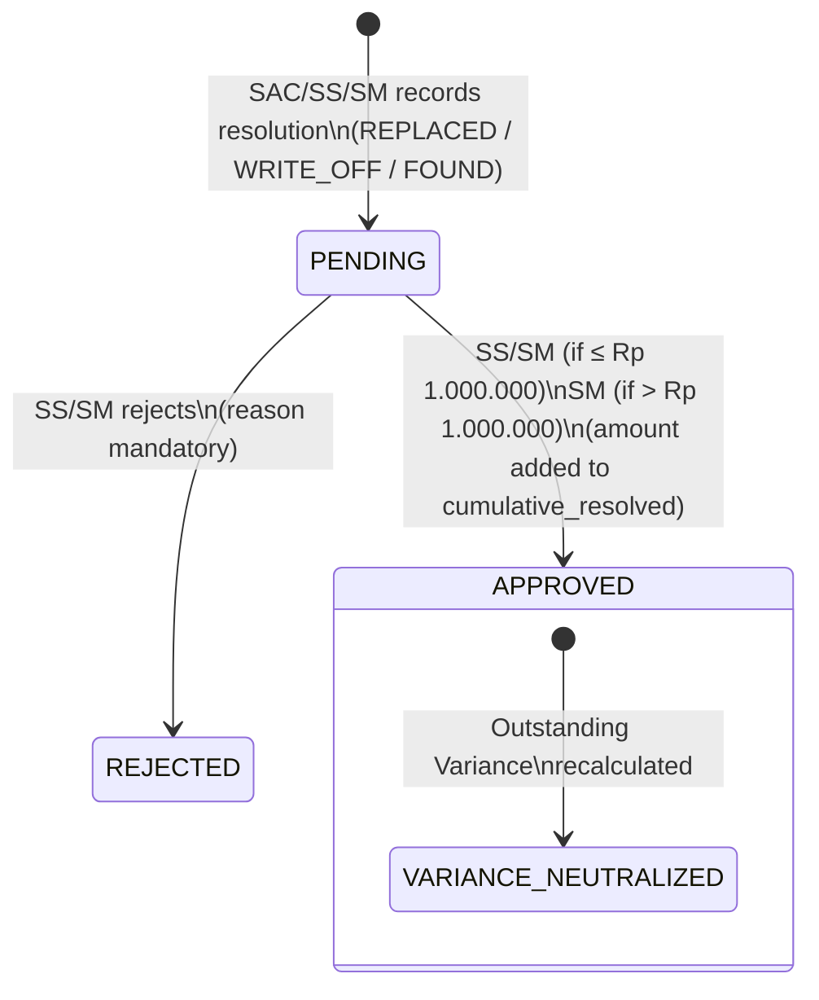
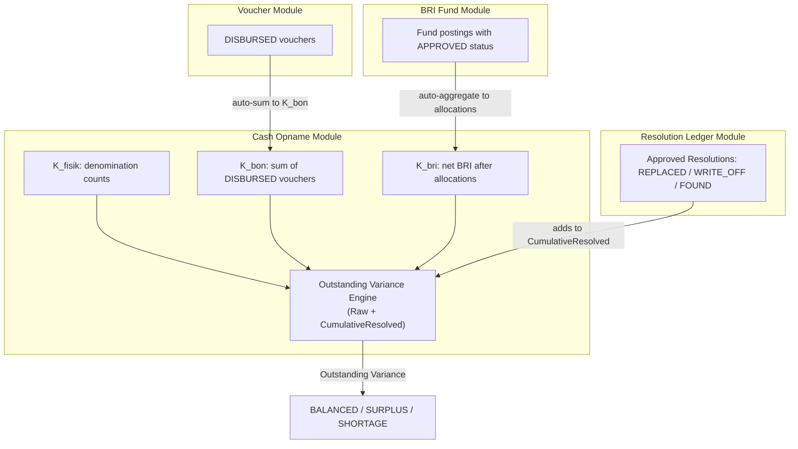

# 06 — Workflow & State Machine

## 1. Voucher Bon Kas Kecil Lifecycle

### Transition Table

| From | To | Actor | Conditions | Side Effects |
|---|---|---|---|---|
| - | DRAFT | SOA/SS/SAC | — | Generate voucher number |
| DRAFT | SUBMITTED | Owner | Foto struk wajib (`receipt_image` != null) | Notify SS/SAC |
| DRAFT | (deleted) | Owner | Only own drafts | Soft delete |
| SUBMITTED | APPROVED_SS | SS/SAC/SM | Anti self-approval check | Notify SAC |
| SUBMITTED | REJECTED | SS/SAC/SM | Reason text required | Notify requester |
| APPROVED_SS | DISBURSED | SAC | — | Set disbursed_at, enters K_bon |
| APPROVED_SS | REJECTED | SAC/SM | — | Notify requester |
| DISBURSED | SETTLED | SAC | Grouped into `PettyCashSettlement` | Set `settled_at`, set `settlement_id`, exits K_bon |
| DISBURSED | REJECTED_REFUND_PENDING | SAC/SM | — | Staff must return cash |
| REJECTED_REFUND_PENDING | REFUNDED | SAC | Cash returned confirmed | Exits K_bon |
| (import) | SETTLED | SM/SAC | Excel commit with status `SETTLED` | `approved_by` & `disbursed_by` set to actor; backdated; exits K_bon |
| (import) | DISBURSED | SM/SAC | Excel commit with status `DISBURSED` | `approved_by` & `disbursed_by` set to actor; backdated; enters K_bon |

---

### 1.1. Petty Cash Settlement Recap (KKCL) Lifecycle

- **Instant Settlement**: Rekap diselesaikan langsung oleh kasir (SAC) tanpa approval bertingkat di level toko.
- **Export & Print**: Siap cetak langsung A4 Landscape (CSS `@media print`) dan ekspor spreadsheet `.xlsx` dengan format matriks kolom kategori.

---

### 1.2. Master Petty Cash Category Lifecycle

- **Scope Rules**:
  - Global Category: Dibuat dan dikelola secara terpusat oleh `SYSTEM_ADMIN` (`store_id = NULL`).
  - Store-Specific Category: Dibuat oleh kasir/manager toko (`store_id = current_store_id`).
- **Active Filter**: Hanya kategori berstatus `is_active = true` yang muncul pada formulir pengajuan bon kas kecil dan pivot rekapitulasi.

---

## 2. Cash Opname Session Lifecycle

### Transition Table

| From | To | Actor | Conditions | Side Effects |
|---|---|---|---|---|
| - | DRAFT | SAC | No existing active draft for type & date | Init items, fetch last approved variance |
| DRAFT | SUBMITTED | SAC | All items counted. If KAS_BESAR: min 1 Z-Report & photo proof attached | Notify SS, lock draft |
| SUBMITTED | VERIFIED_SS | SS | Physical safe verification completed | Set verified_by_ss, verified_ss_at |
| SUBMITTED | DRAFT | SS | Count mismatch | Reason text mandatory, return to SAC |
| VERIFIED_SS | APPROVED | SM | confirm_understanding = true | **LOCK ALL DATA (Immutable Snapshot)**, set approved_sm_at, record final outstanding variance |
| VERIFIED_SS | DRAFT | SM | Reconciliation issues | Reason text mandatory, return to SAC |

---

## 3. BRI Fund Posting Lifecycle (SAC Operational Control & Legacy Approvals)

### Transition Table

| From | To | Actor | Conditions | Side Effects |
|---|---|---|---|---|
| - | APPROVED | SAC/SS | type=INFLOW, proof attached | Running balance increases |
| - | APPROVED | SAC | type=OUTFLOW, amount ≤ balance (Zero-Deficit Guard), proof attached | Running balance decreases immediately, notification sent to SS/SM |
| - | PENDING_SS | System / Legacy | Historical / legacy unapproved outflow | Awaiting supervisor sign-off |
| PENDING_SS | APPROVED | SS/SM | Dual control (not creator). If amount > Rp 500.000: **SM only** | Running balance decreases |
| PENDING_SS | REJECTED | SS/SM | Reason required | Balance unchanged |

---

## 4. Variance Resolution Ledger Lifecycle

### Transition Table

| From | To | Actor | Conditions | Side Effects |
|---|---|---|---|---|
| - | PENDING | SAC/SS/SM | Valid session, reason and proof attached | Logged in resolution ledger |
| PENDING | APPROVED | SS / SM | If kind=WRITE_OFF and amount > Rp 1.000.000: **SM only** | Add to cumulative_resolved_cents, neutralize Outstanding Variance |
| PENDING | REJECTED | SS / SM | Reason text required | Variance unchanged |

---

## 5. Cross-Module Interactions

### Key Integration Points

1. **Voucher → Opname**: K_bon is the real-time sum of all DISBURSED vouchers for the current store. When a voucher is SETTLED or REFUNDED, K_bon decreases.

2. **BRI Postings → Opname**: BRI allocation values in the opname sub-ledger are computed from the aggregate running balances of all APPROVED fund postings, grouped by category.

3. **Outstanding Variance & Resolution Ledger → Next Session**: Sesi menghitung $RawDiscrepancy = TotalActual - TargetAmount$. Resolusi yang disetujui (`APPROVED`) menambah $CumulativeResolved$. $OutstandingVariance = RawDiscrepancy + CumulativeResolved$ menjadi penentu status `BALANCED` / `SURPLUS` / `SHORTAGE`. Nilai outstanding variance yang belum terselesaikan terbawa ke sesi berikutnya per tipe opname tanpa osilasi.

4. **Opname Approval → Snapshot**: At approval time, system snapshots:
   - All denomination and physical item counts
   - All reference lines (Z-Report, opening float, drops) and uploaded physical proofs
   - All BRI allocation balances at that moment
   - All DISBURSED voucher IDs and amounts at that moment
   - These snapshots are stored in related tables and become immutable
