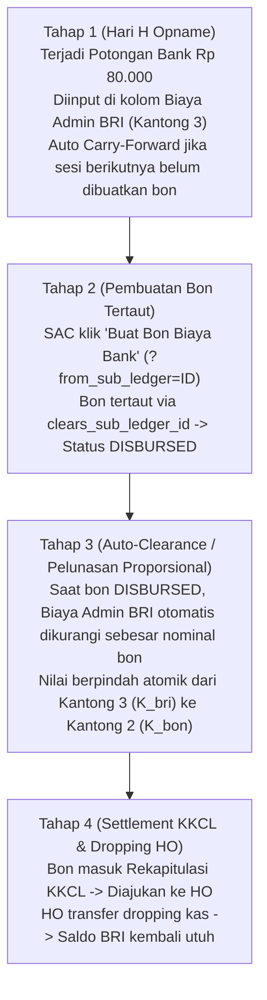

# 15 — SOP & Perlakuan Biaya Administrasi & Transfer Bank pada Cash Opname

Dokumen ini merupakan panduan standar operasional (*Standard Operating Procedure*) mengenai tata cara pencatatan dan perlakuan akuntansi untuk **potongan biaya administrasi bulanan rekening dan biaya transfer bank (BI-Fast / transaksi)** pada sesi Cash Opname Kas Kecil di sistem G-COINS.

---

## 1. Latar Belakang & Masalah Operasional di Toko

Pada sistem dana tetap (*Imprest Fund System*), toko Gramedia memiliki plafon kas operasional (contoh: Rp 5.000.000) yang terbagi dalam Model 3 Kantong:
1. **Kantong 1 ($K_{\text{fisik}}$)**: Fisik uang tunai di brankas kasir.
2. **Kantong 2 ($K_{\text{bon}}$)**: Bon gantung pengeluaran kasir yang sudah cair (`DISBURSED`).
3. **Kantong 3 ($K_{\text{bri}}$)**: Porsi kas kecil yang tersimpan di rekening operasional/pooling BRI toko.

### Masalah yang Terjadi di Lapangan:
* Bank BRI secara otomatis memotong **biaya admin bulanan** rekening dan **biaya transfer operasional** (autodebit) langsung dari saldo rekening toko.
* Pada hari pelaksanaan opname kas (Hari H), kasir (*Store Accounting* / SAC) melihat saldo riil mutasi rekening koran telah berkurang (contoh: berkurang Rp 80.000).
* Biaya bank tersebut **belum sempat dibuatkan Bon Kas Kecil (*Petty Cash Voucher*)** pada hari H karena menunggu kelengkapan bukti cetak koran atau penutupan buku periodik.
* Jika kasir menginput saldo riil rekening koran apa adanya tanpa penyesuaian, sistem opname akan memicu **selisih minus semu (*Shortage*) sebesar Rp 80.000**, padahal kasir tidak menghilangkan uang fisik.
* Di sisi lain, jika kasir menggabungkan Rp 80.000 langsung ke saldo mutasi koran, angka di sistem akan berbeda dengan bukti fisik PDF/foto rekening koran yang diunggah, yang berpotensi menjadi **temuan pelanggaran audit internal**.

---

## 2. Definisi & Aturan Pokok Akuntansi

1. **Biaya Bank Bukan Uang Keluar Fisik Brankas**:
   Biaya bank adalah mutasi non-tunai perbankan. Kasir **dilarang mengeluarkan uang tunai dari brankas** untuk mengganti biaya bank tanpa prosedur pencairan resmi.
2. **Pemisahan Kolom Input di Sub-Ledger BRI**:
   Sistem G-COINS memisahkan input menjadi dua:
   - **Saldo Rekening Koran**: Wajib diisi persis sesuai angka yang tertera pada lembar bukti rekening koran/mutasi BRI yang diunggah.
   - **Biaya Admin & Transfer Bank**: Diisi sebesar potongan biaya bank yang **BELUM** diajukan menjadi Bon Kas Kecil.
3. **Status "Penambah Sementara"**:
   Biaya bank diakui sebagai penambah sementara pada Kantong 3 ($K_{\text{bri}}$) hanya selama bon kas kecil resminya belum terbit.

---

## 3. Formula Matematika Model 3 Kantong (Revisi)

$$\text{Total Actual} = K_{\text{fisik}} + K_{\text{bon}} + K_{\text{bri}}$$

Dimana perhitungan Kantong 3 ($K_{\text{bri}}$) adalah:

$$K_{\text{bri}} = (\text{Saldo Rekening Koran} - \text{Total Alokasi Non-Kas Kecil}) + \text{Biaya Admin Bank}$$

### Contoh Kasus Seimbang (Balanced):
* Plafon Imprest Fund Toko = **Rp 5.000.000**
* Fisik Brankas ($K_{\text{fisik}}$) = Rp 2.000.000
* Bon Belanja ($K_{\text{bon}}$) = Rp 1.500.000
* Rekening Koran BRI:
  - Saldo Riil di Koran = Rp 1.420.000
  - Biaya Admin & Transfer = Rp 80.000
  - Alokasi Non-Kas (B2B, Event, dll) = Rp 0
  - Net $K_{\text{bri}} = (1.420.000 - 0) + 80.000 = \mathbf{\text{Rp } 1.500.000}$

$$\text{Total Actual} = 2.000.000 + 1.500.000 + 1.500.000 = \mathbf{\text{Rp } 5.000.000} \quad (\mathbf{BALANCED})$$

---

## 4. Siklus Hidup Transisi 4 Tahap (The 4-Stage Lifecycle)

Agar kas kecil tetap seimbang dan uang penggantian dari Kantor Pusat (*Head Office*) dapat dicairkan tanpa risiko *double-counting* atau lupa reset manual, transaksi ini melewati 4 siklus transisi terotomasi:

### Tabel Rincian Pergerakan Dana:

| Tahapan | Kantong 1 ($K_{\text{fisik}}$) | Kantong 2 ($K_{\text{bon}}$) | Kantong 3 ($K_{\text{bri}}$) | Total Aktual | Status Audit |
|---|---|---|---|---|---|
| **Tahap 1 (Hari H)** Biaya bank terjadi, belum ada bon | Rp 2.000.000 | Rp 1.500.000 | Koran: Rp 1.420.000 Biaya: **+Rp 80.000** Total: **Rp 1.500.000** | **Rp 5.000.000** | `BALANCED` |
| **Tahap 1B (Jika Belum Buat Bon di H+1)** Auto Carry-Forward (+ potongan baru Rp 20.000) | Rp 2.000.000 | Rp 1.500.000 | Koran: Rp 1.400.000 Biaya: **+Rp 100.000** *(Akumulasi)* Total: **Rp 1.500.000** | **Rp 5.000.000** | `BALANCED` |
| **Tahap 2 & 3 (Saat Bon Cair `DISBURSED`)** SAC mencairkan bon biaya bank tertaut | Rp 2.000.000 | Naik otomatis menjadi **Rp 1.580.000** (`DISBURSED`) | Koran: Rp 1.420.000 Biaya: **Rp 0** *(Auto-Cleared)* Total: **Rp 1.420.000** | **Rp 5.000.000** | `BALANCED` |
| **Tahap 4 (Dropping HO)** Rekap KKCL diganti pusat | Rp 2.000.000 | **Rp 0** *(Settled)* | Koran: **Rp 3.000.000** *(Dropping masuk)* Total: **Rp 3.000.000** | **Rp 5.000.000** | `BALANCED` |

---

## 5. Otomasi Sistemik: Auto Carry-Forward, Tautan ID, & Auto-Clearance (Opsi B)

Sistem G-COINS mengotomatiskan siklus transisi ini dari hulu ke hilir agar tidak bergantung pada ingatan manual kasir:

### 5.1 Auto Carry-Forward & Akumulasi Bertahap Antar Sesi
- Saat sesi opname `KAS_KECIL` baru dibuka (`OpenSessionAction`), sistem memeriksa sesi `APPROVED` terakhir di toko yang sama.
- Apabila sesi sebelumnya memiliki `bank_admin_fee_cents > 0` dan belum memiliki `cleared_by_voucher_id` (belum dilunasi oleh bon kas kecil), maka nominal dan keterangannya **otomatis terbawa (*carry-forward*)** ke sesi opname baru.
- **Fleksibilitas Penambahan Nilai (Akumulasi)**: Jika biaya admin sesi sebelumnya belum sempat dibuatkan bon, lalu pada sesi berikutnya terjadi potongan biaya transfer/admin bank tambahan (misal dari Rp 80.000 bertambah Rp 20.000 menjadi Rp 100.000), SAC cukup mengubah angka di kolom *Biaya Admin & Transfer Bank* menjadi total akumulasi terbaru (`Rp 100.000`) dan memperbarui keterangannya.

### 5.2 Autosave (800ms) & Proteksi Simpan Otomatis Saat Klik "Ajukan"
- Setiap perubahan pada kolom *Saldo Rekening Koran*, *Biaya Admin & Transfer Bank*, maupun *Keterangan Rincian Biaya Bank* pada halaman Opname Aktif dilengkapi dengan **autosave otomatis (jeda 800ms)**.
- Apabila SAC langsung menekan tombol **"Ajukan"** sebelum menekan tombol *"Simpan Rekonsiliasi BRI"* atau sebelum jeda autosave selesai, sistem secara sekuensial **menyimpan perubahan BRI terlebih dahulu ke server** baru kemudian mengeksekusi pengajuan sesi (`SubmitSessionAction`), sehingga nilai biaya admin dijamin tidak pernah hilang/reset.
- Pada penyimpanan manual maupun pengajuan sesi, apabila `bank_admin_fee_cents > 0`, kolom `bank_admin_fee_notes` **wajib diisi** (contoh: *"Admin bulanan Okt Rp 50rb + 12x BI-Fast Rp 30rb"*).

### 5.3 Mekanisme Tautan Referensi (`clears_sub_ledger_id`) — Bebas Ubah Keterangan & Kategori
- Pembuatan bon biaya bank dapat dilakukan melalui dua jalur yang sama-sama menautkan ID secara otomatis:
  1. Klik tombol pintasan **"Buat Bon Biaya Bank →"** langsung dari kartu Sub-Ledger BRI di halaman **Sesi Opname Aktif** (`/vouchers/create?from_sub_ledger={id}`).
  2. Membuka menu **Buat Bon Kas Kecil** (`/vouchers/create`), di mana sistem otomatis mendeteksi adanya biaya admin bank tertunda dan menampilkan banner biru dengan tombol **"Isi & Tautkan Otomatis"** (atau langsung tertaut dengan badge `✓ Tertaut Otomatis` jika masuk dari pintasan opname).
- Formulir bon otomatis mengisi nominal (`amount_cents`) dan rincian keterangan (`purpose`), serta menyisipkan kunci relasi tersembunyi `clears_sub_ledger_id` yang disimpan pada tabel `petty_cash_vouchers`.
- **Ketahanan Terhadap Perubahan Teks & Kategori**: Karena pelunasan dideteksi berdasarkan kunci relasi database (`petty_cash_vouchers.clears_sub_ledger_id` $\rightarrow$ `bri_sub_ledgers.id`) dan **bukan** berdasarkan pencocokan teks atau nama kategori:
  - Kasir **bebas mengubah teks keterangan (`purpose`)** sesuai kebutuhan administrasi toko.
  - Kasir atau penyetuju (SS/SAC/SM) **bebas memilih atau mereklasifikasi kategori pos beban (`category`) apapun** (baik `LAINNYA`, `OPERASIONAL`, maupun kategori kustom toko).
  - Selama bon tersebut dibuat melalui tautan (`clears_sub_ledger_id` terisi), sistem **tetap 100% mengenali dan memproses pelunasan otomatis** saat bon tersebut dicairkan (`DISBURSED`).

### 5.4 Pelunasan Proporsional Otomatis Saat Bon Cair (`DISBURSED`) & Pembatalan (`Cancel`)
- Begitu bon yang memiliki `clears_sub_ledger_id` dicairkan (`DisburseVoucherAction` $\rightarrow$ status `DISBURSED`), sistem secara atomik di dalam satu transaksi database:
  1. Menandai seluruh `BriSubLedger` di toko tersebut yang masih memiliki biaya admin belum lunas dengan `cleared_by_voucher_id = voucher.id` dan `cleared_at = now()`.
  2. Jika terdapat sesi opname `KAS_KECIL` yang sedang berstatus `DRAFT`, sistem langsung **mengurangi `bank_admin_fee_cents` secara proporsional**:
     $$\text{Sisa Biaya Admin} = \max(0, \text{Biaya Admin Saat Ini} - \text{Nominal Bon Cair})$$
  3. Menghitung ulang $K_{\text{bri}}$ dan rekonsiliasi 3-kantong sesi `DRAFT` tersebut secara otomatis.
- **Dukungan Pelunasan Penuh maupun Parsial**:
  - Jika akumulasi biaya admin Rp 100.000 dibuatkan 1 bon penuh Rp 100.000, maka saat bon cair, biaya admin di opname langsung menjadi **Rp 0**.
  - Jika akumulasi biaya admin Rp 100.000 baru dibuatkan bon Rp 80.000, maka saat bon cair, biaya admin di opname otomatis berkurang menjadi **Rp 20.000** (sisanya tetap terjaga hingga dibuatkan bon berikutnya).
- **Reversal Otomatis Saat Bon Dibatalkan**: Apabila bon biaya bank yang sudah cair terpaksa dibatalkan (`CancelVoucherAction`), sistem otomatis menghapus penanda `cleared_by_voucher_id` dan `cleared_at` sehingga saldo biaya admin kembali berstatus belum lunas.

---

## 6. Panduan Tugas Peran (*Role Responsibilities*)

### Kasir / Store Accounting (SAC):
1. Input **Saldo Rekening Koran** sesuai angka riil lembar rekening koran yang tertera pada mutasi bank.
2. Unggah foto atau dokumen PDF rekening koran yang jelas memperlihatkan saldo akhir dan baris mutasi potongan biaya bank.
3. Jika terdapat potongan biaya bank yang belum dibuatkan bon kas kecil, input nominalnya di kolom **Biaya Admin & Transfer Bank** beserta **Keterangan Rincian Biaya Bank** (sistem akan menyimpannya secara otomatis).
4. Klik tombol pintasan **"Buat Bon Biaya Bank →"** pada kartu Sub-Ledger BRI (atau klik *"Isi & Tautkan Otomatis"* pada banner halaman Buat Bon Kas Kecil) untuk mengajukan Bon Kas Kecil resmi sebelum jadwal rekapitulasi KKCL bulanan. Keterangan dan kategori pos beban dapat disesuaikan dengan bebas karena bon sudah tertaut otomatis (`✓ Tertaut Otomatis`).
5. Setelah bon disetujui atasan dan dicairkan (`DISBURSED`), sistem **secara otomatis mengurangi/meng-nol-kan** kolom *Biaya Admin & Transfer Bank* dan memindahkan nilainya ke $K_{\text{bon}}$ tanpa perlu di-reset manual oleh SAC.

### Store Supervisor (SS - Saksi Opname):
1. Memverifikasi kesesuaian fisik rekening koran dengan angka yang diinput di sistem.
2. Memeriksa rincian keterangan pada baris *Biaya Admin & Transfer Bank* serta memastikan potongan tersebut memang tercantum pada mutasi rekening koran.
3. Menyetujui pengajuan Bon Kas Kecil atas biaya admin bank yang dibuat oleh SAC (sesuai prinsip *Anti Self-Approval*).

### Store Manager (SM - Pengesah Final):
1. Meneliti lembar Berita Acara Cash Opname (BACO) pada baris **3.2 Biaya Admin & Transfer Bank** beserta catatan rinciannya.
2. Memastikan status opname seimbang secara wajar dan menandatangani Berita Acara.

### Internal Auditor:
1. Memeriksa dokumen BACO baris 3.1 (Saldo Koran) terhadap lampiran dokumen fisik rekening koran.
2. Memeriksa bahwa baris 3.2 (Biaya Admin & Transfer Bank) memiliki rincian catatan (`bank_admin_fee_notes`), bukti mutasi autodebit bank, dan jejak keterkaitan (`cleared_by_voucher_id` / `clears_sub_ledger_id`) yang menjamin tidak terjadinya duplikasi dengan bon kas kecil aktif di $K_{\text{bon}}$.

